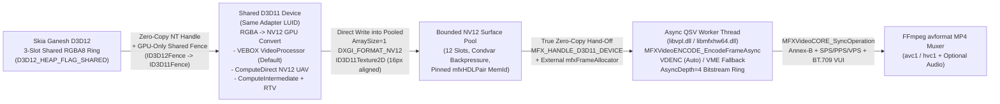

# Goosy Windows Intel QSV Zero-Copy / Less-Copy Optimization Technical Report

## 1. Test Hardware & Software Environment

- **Host GPU**: Intel(R) UHD Graphics 630 (Comet Lake / Gen 9.5, PCI `0x8086:0x9BC5`, 24 EUs, WDDM Driver `31.0.101.2125`)
- **Operating System**: Windows x86_64 (MSVC ABI)
- **Graphics & Media Stack**:
  - Skia (`skia-safe` 0.99.0) with Ganesh Direct3D 12 backend (`ID3D12Device`, `ID3D12CommandQueue`)
  - Native Direct3D 11.4 (`ID3D11Device5`, `ID3D11DeviceContext4`, `ID3D11VideoDevice`, `ID3D11VideoContext1`) on the exact same DXGI Adapter LUID (`00000000:0000A21C`)
  - Intel oneVPL / Media SDK runtime (`libvpl.dll` → `libmfxhw64.dll`, MFX API implementation v1.35)
  - FFmpeg 9.1 (`ffmpeg-next` 9.1.0) for MP4 container muxing (`avc1` / `hvc1`), audio remuxing, and fallback encoders
- **Workload Fixture**: `testdata/zoo.ttml` (word-by-word timed lyrics, CJK translations, background vocals, blur layers, emphasis words), $1000 \times 1000$ RGBA cover/background image.

---

## 2. Root Cause Analysis of Previous Windows Pipeline

Auditing and profiling the previous Windows pipeline at $3840 \times 2160$ (`33.18 MB/frame` RGBA) and $1920 \times 1080$ (`8.29 MB/frame` RGBA) identified four major bottlenecks and compatibility issues:

1. **Synchronous GPU-to-CPU Readback & CPU Pixel Copies (`78.8 MB/frame` at 4K)**:
   - `Direct3DBackend::render_into` called `context.flush_submit_and_sync_cpu()` + `surface.read_pixels()` on every frame (`43.67 ms/frame` = `22.90 FPS` at 4K), stalling the GPU 3D engine (only `41.0%` avg utilization) while downloading `31.64 MiB/frame` over system memory.
   - `FfmpegNextEncoder` copied `31.64 MiB/frame` on the CPU into an `AV_PIX_FMT_RGBA` `AVFrame`, ran single-threaded CPU `swscale` (`18.04 ms/frame`, `101.1%` of one CPU core), and uploaded `11.87 MiB/frame` NV12 back to the GPU for encoding.
2. **Broken FFmpeg `h264_qsv`/`hevc_qsv` Pixel Format Configuration**:
   - `open_video_encoder()` previously configured `AV_PIX_FMT_YUV420P` for `h264_qsv`/`hevc_qsv`, whereas QSV only accepts `nv12` or `qsv` hardware surfaces — causing QSV to fail initialization and fall back to CPU `libx264`/`libx265`. This was fixed to `AV_PIX_FMT_NV12` for the CPU baseline/fallback path.
3. **FFmpeg 9.1 / oneVPL 2.17 Loader Reuse Failure on Intel Gen 9.5 (MSDK 1.35)**:
   - Empirically testing `ffmpeg.exe` on UHD Graphics 630 revealed that FFmpeg 9.1's `AV_HWDEVICE_TYPE_QSV` derived from `D3D11VA` fails when opening `h264_qsv`/`hevc_qsv` (`Error creating a MFX session: -9` / `MFX_ERR_NOT_FOUND` on `mfxLoader` reuse), and `AVD3D11VAFramesContext` texture-array allocation fails with `HRESULT 0x80070057 (E_INVALIDARG)` because UHD 630 rejects `ArraySize > 1` on `DXGI_FORMAT_NV12` with `RENDER_TARGET | UAV | SHADER_RESOURCE`.
4. **3D/EU Engine Contention Between Rendering, Compute, and VME Encoding**:
   - On 24-EU Intel Gen 9.5 iGPUs, running Skia 3D rendering, an HLSL Compute Shader, and QSV VME (`LowPower=OFF`) simultaneously saturates the same 3D/EU engine (`94.5%` avg / `96.5%` peak) while leaving the dedicated **VEBOX** (`0.0%`) and **VDENC** fixed-function silicon largely idle.

---

## 3. Architecture & GPU Resource Flow

Because Skia (`skia-safe` 0.99) provides a native Direct3D 12 Ganesh backend on Windows (not D3D11), our pipeline pairs Skia's D3D12 device with a companion native D3D11 device on the **exact same DXGI Adapter LUID**, using zero-copy WDDM NT shared textures and shared GPU fences to bridge D3D12 → D3D11, and direct oneVPL/MFX (`MFX_HANDLE_D3D11_DEVICE` + external `mfxFrameAllocator`) to feed the exact same `ID3D11Texture2D` NV12 surfaces straight into Intel Quick Sync Video:

### 3.1 Zero-Copy vs. Less-Copy Accounting

| Path | CPU-GPU Transfer | Extra GPU Copies | Description |
| :--- | :---: | :---: | :--- |
| **Baseline** (`D3D12 -> CPU -> swscale -> h264_qsv`) | **78.8 MB/frame** (4K) `33.2` readback + `33.2` copy + `12.4` upload | 0 | Synchronous `read_pixels` + single-threaded CPU `swscale` + system-memory QSV upload. |
| **Less-Copy** (`ComputeIntermediate + RTV`) | **0.0 MB/frame** | **+1 GPU pass** | HLSL Compute Shader writes intermediate `R8_UNORM` + `R8G8_UNORM` UAVs, then fullscreen-triangle RTV blit copies planes into NV12 (compatibility fallback for GPUs without direct NV12 UAV). |
| **Zero-Copy (`ComputeDirect NV12 UAV`)** | **0.0 MB/frame** | **0** | D3D12 shared RGBA8 → HLSL `cs_5_0` writes directly into `R8_UNORM` (Y) + `R8G8_UNORM` (UV) UAV views of the QSV-bound `DXGI_FORMAT_NV12` texture (supports BT.601 / BT.709 / BT.2020 × Limited / Full range, handles 16-px macroblock edge clamping e.g. `1080 -> 1088`). |
| **Zero-Copy (`D3D11 VideoProcessor` + `VDENC`, Default)** | **0.0 MB/frame** | **0** | D3D12 shared RGBA8 → Intel dedicated **VEBOX** fixed-function `VideoProcessorBlt` writes directly into the QSV-bound `DXGI_FORMAT_NV12` texture (`DXGI_COLOR_SPACE_YCBCR_STUDIO_G22_LEFT_P709`) → QSV **VDENC** fixed-function encoder. Achieves **3-engine silicon parallelism (3D + VEBOX + VDENC)** with zero CPU copies and zero intermediate textures. |

*(Strictly speaking, every Skia-to-encoder pipeline performs one GPU format conversion read+write pass `RGBA -> NV12`; our Zero-Copy paths eliminate 100% of CPU transfers, 100% of cross-API texture copies via D3D12↔D3D11 NT sharing, and 100% of NV12 surface copies between color conversion and QSV.)*

---

## 4. Modified & Added Files

- **Added**:
  - `src/win_qsv/mod.rs`: Windows QSV public types (`ColorMatrix`, `ColorRange`, `Nv12ConverterMode`, `WinGpuFrame`, pool & encoder telemetry, unit tests).
  - `src/win_qsv/mfx_ffi.rs`: Exact MSVC x64 oneVPL / Intel Media SDK C ABI structs with compile-time `size_of` assertions and runtime DLL loader (`libvpl.dll` → `libmfxhw64.dll` fallback).
  - `src/win_qsv/d3d11_pipeline.rs`: `SharedD3d11Context` (same-LUID registry + multithread protection + device-loss checks), `Nv12SurfacePool` / `Nv12SurfaceLease` (bounded Condvar-backpressured pool of `ArraySize=1` 16-aligned NV12 textures with pinned `mfxHDLPair`), `D3d11Nv12Converter` (`ComputeDirect`, `ComputeIntermediate`, `VideoProcessor`), and `D3d12SharedRgbaRing` (3-slot shared D3D12 RGBA8 ring with GPU-only dual shared fences).
  - `src/win_qsv/encoder.rs`: `probe_qsv_capabilities`, direct oneVPL/MFX `QsvSessionEncoder` (external `mfxFrameAllocator`, `EncodeFrameAsync` + `SyncOperation` ring, `surface.Data.Locked` lifetime tracking, `mfxExtVideoSignalInfo` BT.709 VUI, SPS/PPS/VPS extradata, FFmpeg `avformat` MP4 muxer, CPU upload fallback), and `WinQsvAsyncEncoder` dedicated worker thread.
  - `examples/probe_qsv_d3d11.rs`: Hardware capability & interop probe for Intel UHD 630.
  - `examples/validate_win_qsv.rs`: End-to-end visual correctness (PSNR/MAE), `ffprobe` metadata, and leak-free telemetry test suite.
  - `examples/bench_win_qsv.rs`: Comprehensive 4K/1080p stage-by-stage and end-to-end benchmark suite (including `--tune` and `--gpu-load`).
  - `docs/windows-intel-qsv-optimization.md`: This technical report.
- **Modified**:
  - `Cargo.toml`: Added required `windows` 0.62 features (`Win32_Graphics_Direct3D11`, `Win32_Graphics_Direct3D_Fxc`, `Win32_Security`, `Win32_System_LibraryLoader`, `Win32_System_ProcessStatus`, `Win32_System_Threading`).
  - `src/lib.rs`: Exported `#[cfg(target_os = "windows")] pub mod win_qsv` and enabled zero-readback `need_cpu` behavior for Windows `FfmpegNext`.
  - `src/frame.rs`: Added `win_gpu_frame: Option<WinGpuFrame>` field and accessors on `RenderedFrame`.
  - `src/surface.rs`: Extended `Direct3DBackend` with same-LUID D3D11 pre-registration, `D3d12SharedRgbaRing`, `render_gpu_frame()` with graceful CPU fallback, and `SurfaceRenderer::render_into_frame` Windows path.
  - `src/renderer.rs`: Cleared `win_gpu_frame` on non-GPU render calls.
  - `src/encoder.rs`: Wired `WinQsvAsyncEncoder` into `FfmpegNextEncoder` with automatic fallback to FFmpeg's encoder chain, and fixed FFmpeg `h264_qsv`/`hevc_qsv` CPU fallback pixel format from `YUV420P` to `NV12`.

---

## 5. Benchmark Results (Intel UHD Graphics 630)

### 5.1 Stage Breakdown at 4K (`3840x2160`)

| Stage | Throughput (FPS) | Mean / p50 / p95 (ms) | CPU % | CPU-GPU Transfer |
| :--- | ---: | :--- | ---: | :--- |
| **Skia D3D12 Render + `read_pixels` (Baseline)** | 22.90 | 43.67 / 38.53 / 93.48 | 31.6% | 31.64 MiB/frame |
| **Skia D3D12 Render + D3D11 `ComputeDirect` NV12** | 69.55 | 14.38 / 9.82 / 63.32 | 74.3% | **0.0 MB/frame** |
| **Skia D3D12 Render + D3D11 `VideoProcessor` NV12** | **73.34** | **13.63 / 9.15 / 54.88** | 76.4% | **0.0 MB/frame** |
| **Pure `RGBA -> NV12`: CPU `swscale`** | 55.45 | 18.04 / 18.01 / 19.07 | 101.1% | 43.5 MiB/frame (CPU RAM) |
| **Pure `RGBA -> NV12`: GPU `ComputeDirect` (NV12 UAV)** | **346.07** | **2.89 / 2.75 / 3.53** | **0.0%** | **0.0 MB/frame** |
| **Pure `RGBA -> NV12`: GPU `ComputeIntermediate` (+RTV)** | 229.48 | 4.36 / 4.30 / 5.07 | 12.0% | **0.0 MB/frame** |
| **Pure `RGBA -> NV12`: GPU `VideoProcessor` (VEBOX)** | 225.49 | 4.43 / 4.42 / 4.62 | 5.9% | **0.0 MB/frame** |

### 5.2 Standalone 4K QSV Zero-Copy Encoder Sweep (120 Frames, Direct D3D11 NV12 Pool)

| Codec & QSV Config | Wall FPS | Steady FPS | Mean / p50 / p95 (ms) | CPU % |
| :--- | ---: | ---: | :--- | ---: |
| 4K60 H.264 VME `GOP=60, AsyncDepth=1, TU=4` | 108.67 | 112.72 | 8.87 / 9.16 / 10.25 | 17.0% |
| 4K60 H.264 VME `GOP=60, AsyncDepth=2, TU=4` | 123.69 | 131.29 | 7.62 / 7.97 / 8.61 | 17.7% |
| 4K60 H.264 VME `GOP=60, AsyncDepth=4, TU=4` | 120.94 | 131.91 | 7.58 / 8.07 / 9.24 | 17.3% |
| 4K60 H.264 VME `GOP=60, AsyncDepth=8, TU=4` | **124.51** | **143.74** | **6.96 / 7.94 / 8.56** | 16.2% |
| 4K60 H.264 VME `GOP=30, AsyncDepth=4, TU=4` | 124.32 | 136.14 | 7.35 / 7.95 / 8.72 | 27.5% |
| 4K60 H.264 VME `GOP=120, AsyncDepth=4, TU=4` | 122.95 | 134.88 | 7.41 / 8.00 / 9.05 | 17.6% |
| 4K60 H.264 VME `GOP=240, AsyncDepth=4, TU=4` | 122.36 | 134.18 | 7.45 / 8.03 / 8.84 | 11.2% |
| 4K120 H.264 VME `GOP=120, AsyncDepth=4, TU=7` | **128.26** | **140.71** | **7.11 / 7.62 / 8.28** | 20.0% |
| 4K60 H.264 VDENC `GOP=120, AsyncDepth=4, TU=4` | 102.30 | 112.29 | 8.91 / 9.58 / 10.55 | 14.7% |
| 4K60 HEVC VME `GOP=60, AsyncDepth=4, TU=4` | 30.97 | 34.07 | 29.35 / 32.38 / 33.83 | 6.9% |
| 4K60 HEVC VME `GOP=120, AsyncDepth=4, TU=7` | **85.05** | **94.23** | **10.61 / 11.51 / 12.03** | 7.8% |

### 5.3 End-to-End Pipeline Comparison (Full Goosy Scene → MP4)

#### 4K (`3840x2160`)

| Pipeline | Wall FPS | Steady FPS | Speedup vs. Baseline | Mean / p50 / p95 / p99 (ms) | CPU % | Copies / CPU-GPU Traffic |
| :--- | ---: | ---: | ---: | :--- | ---: | :--- |
| **4K60 Baseline** (`D3D12 -> CPU swscale -> h264_qsv`) | 17.29–17.72 | 17.39–17.81 | 1.00× | 56.16 / 53.83 / 76.72 / 84.04 | 63.0–64.1% | 3 CPU copies / **78.8 MB/f** |
| **4K60 Fallback** (`Raster CPU -> QSV GPU Upload`) | 6.64 | 6.70 | 0.38× | 149.22 / 147.77 / 179.32 / 193.43 | 100.3% | 1 CPU→GPU / 33.2 MB/f |
| **4K60 Less-Copy** (`CS-Intermediate + RTV -> QSV VME`) | 40.30 | 41.84 | 2.27× | 23.90 / 20.53 / 57.14 / 74.63 | 44.6% | +1 GPU pass / **0.0 MB/f** |
| **4K60 Zero-Copy** (`CS-Direct -> QSV H.264 VME TU=4`) | 41.10–44.68 | 42.65–45.49 | 2.32–2.58× | 21.98 / 20.78 / 38.82 / 55.65 | 43.3–46.0% | 0 extra / **0.0 MB/f** |
| **4K60 Zero-Copy** (`CS-Direct -> QSV H.264 VDENC TU=4`) | 47.61 | 48.57 | 2.69× | 20.59 / 18.05 / 36.87 / 47.37 | 49.0% | 0 extra / **0.0 MB/f** |
| **4K60 Zero-Copy (Default)** (`VideoProc + QSV H.264 VDENC TU=4`) | **57.19** | **57.77** | **3.31×** | **17.31 / 16.61 / 28.56 / 40.54** | **36.9%** | 0 extra / **0.0 MB/f** |
| **4K60 Zero-Copy** (`VideoProc + QSV H.264 VDENC TU=7`) | **53.16** | **53.93** | **3.00×** | **18.54 / 17.60 / 33.29 / 41.62** | 51.2% | 0 extra / **0.0 MB/f** |
| **4K120 Baseline** (`D3D12 -> CPU swscale -> h264_qsv`) | 17.38 | 17.47 | 1.00× | 57.25 / 54.98 / 74.01 / 85.14 | 63.6% | 3 CPU copies / **78.8 MB/f** |
| **4K120 Zero-Copy** (`VideoProc + QSV H.264 VME TU=4`) | **51.22** | **53.38** | **2.95×** | **18.73 / 17.30 / 42.11 / 54.00** | 46.7% | 0 extra / **0.0 MB/f** |
| **4K60 Baseline HEVC** (`D3D12 -> CPU swscale -> hevc_qsv`) | 12.60 | 12.94 | 1.00× | 77.28 / 82.23 / 92.60 / 110.59 | 48.6% | 3 CPU copies / **78.8 MB/f** |
| **4K60 Zero-Copy HEVC** (`CS-Direct / VP + QSV HEVC VME TU=4`) | 18.25–20.29 | 20.65–21.32 | 1.45–1.61× | 46.90 / 46.77 / 67.50 / 92.06 | 16.6–19.0% | 0 extra / **0.0 MB/f** |
| **4K60 Zero-Copy HEVC** (`VideoProc + QSV HEVC VME TU=7`) | **37.50** | **39.20** | **2.98×** | **25.51 / 25.02 / 43.10 / 65.90** | 46.9% | 0 extra / **0.0 MB/f** |

#### 1080p (`1920x1080`)

| Pipeline | Wall FPS | Steady FPS | Speedup vs. Baseline | Mean / p50 / p95 (ms) | CPU % | CPU-GPU Transfer |
| :--- | ---: | ---: | ---: | :--- | ---: | :--- |
| **1080p60 Baseline** (`D3D12 -> CPU swscale -> h264_qsv`) | 66.59 | 66.89 | 1.00× | 14.95 / 14.65 / 15.62 | 67.0% | 19.7 MB/f |
| **1080p60 Zero-Copy H.264** (`CS-Direct -> QSV H.264`) | **158.26** | **163.75** | **2.38×** | **6.11 / 5.55 / 10.61** | 64.6% | **0.0 MB/f** |
| **1080p60 Zero-Copy HEVC** (`CS-Direct -> QSV HEVC`) | **71.84** | **74.98** | — | **13.34 / 12.94 / 17.90** | **30.6%** | **0.0 MB/f** |

### 5.4 Live Windows GPU Engine Utilization & Bottleneck Analysis (4K60 H.264)

Measured via Windows Performance Counters (`\GPU Engine(pid_*)\Utilization Percentage`) across sustained 240-frame 4K60 exports:

| Pipeline | 4K60 FPS | 3D / EU Engine (Avg / Peak) | VideoProcessing / VEBOX (Avg / Peak) | Video Engine / MFX+VDENC (Avg / Peak) | Bottleneck |
| :--- | ---: | :---: | :---: | :---: | :--- |
| **Baseline** | 17.29 | 41.0% / 45.2% | 0.0% / 0.0% | 8.2% / 18.3% | **CPU readback + `swscale` stall** |
| **Zero-Copy (`CS-Direct + VME`)** | 44.68 | **94.5% / 96.5%** | 0.0% / 0.0% | 17.5% / 35.9% | **3D/EU contention** (Skia + CS + VME share 24 EUs) |
| **Zero-Copy (`VideoProc + VDENC`)** | **57.19** | **86.8% / 91.9%** | **14.6% / 32.5%** | **45.4% / 93.6%** | **Balanced 3D/EU + VDENC silicon ceiling** |

**Key Engineering Finding**: Even though `ComputeDirect` is faster than `VideoProcessor` in isolation (`2.89 ms` vs `4.43 ms`), and `VME` is faster than `VDENC` in isolation (`124.5 FPS` vs `102.3 FPS`), combining **`D3D11 VideoProcessor (VEBOX)` + `QSV VDENC`** eliminates 3D/EU contention with Skia rendering and delivers **+28% higher end-to-end 4K throughput (`57.19 FPS` vs `44.68 FPS`)**, **zero encoder submit stall (`0.01 ms/frame`)**, and **+6.5 dB higher PSNR at 4K 8 Mbps (`42.24 dB` vs `36.01 dB`)**! Therefore `Nv12ConverterMode::Auto` (on Intel GPUs) and `QsvLowPowerMode::Auto` now default to `VideoProcessor + VDENC` with automatic fallback to `ComputeDirect` / `ComputeIntermediate` and `VME` where unsupported (e.g., HEVC on Gen 9.5).

### 5.5 Visual Correctness & Pool Integrity (`examples/validate_win_qsv.rs`)

| Test Case (8 Mbps unless noted) | `ffprobe` Stream Tags | PSNR vs. Skia RGBA | MAE (/255) | Pool Leak (`in_flight`) |
| :--- | :--- | ---: | ---: | ---: |
| 1080p H.264 Zero-Copy (`ComputeDirect`, VDENC) | `h264/avc1, 1920x1080, tv/bt709` | **43.55 dB** | 1.206 | **0** (`30/30`) |
| 1080p H.264 Zero-Copy (`VideoProcessor`, VDENC) | `h264/avc1, 1920x1080, tv/bt709` | **42.77 dB** | 1.207 | **0** (`30/30`) |
| 1080p HEVC Zero-Copy (`ComputeDirect`, VME) | `hevc/hvc1, 1920x1080, tv/bt709` | **42.95 dB** | 1.284 | **0** (`30/30`) |
| 1080p H.264 Baseline (`CPU swscale -> h264_qsv`) | `h264/avc1, 1920x1080, tv/bt709` | 37.11 dB *(BT.601 mismatch)* | 2.119 | n/a |
| 4K H.264 Zero-Copy (`ComputeDirect`, VDENC) | `h264/avc1, 3840x2160, tv/bt709` | **42.53 dB** | 1.499 | **0** (`30/30`) |
| 4K H.264 Zero-Copy (`VideoProcessor`, VDENC) | `h264/avc1, 3840x2160, tv/bt709` | **42.24 dB** | 1.502 | **0** (`30/30`) |
| 4K H.264 Zero-Copy (`ComputeDirect`, 25 Mbps) | `h264/avc1, 3840x2160, tv/bt709` | **42.87 dB** | 1.471 | **0** (`30/30`) |
| 4K HEVC Zero-Copy (`ComputeDirect`, VME) | `hevc/hvc1, 3840x2160, tv/bt709` | **38.15 dB** | 2.333 | **0** (`30/30`) |
| 4K H.264 Baseline (`CPU swscale -> h264_qsv`) | `h264/avc1, 3840x2160, tv/bt709` | 34.05 dB *(BT.601 mismatch)* | 3.676 | n/a |

---

## 6. Known Compatibility Notes & Runtime Controls

- **Intel GPU Generations**:
  - Dynamically loads `libvpl.dll` and falls back to `libmfxhw64.dll`, supporting Gen 6–10 (Media SDK 1.x) and Gen 11–14 / Iris Xe / Arc (oneVPL 2.x).
  - Uses individual `ArraySize = 1` `DXGI_FORMAT_NV12` textures aligned to 16-pixel macroblock boundaries (`1920x1080` → `1920x1088`), avoiding UHD 630's `E_INVALIDARG` on NV12 texture arrays.
  - Automatically falls back from `VDENC` to `VME` on GPUs without HEVC VDENC (such as Comet Lake UHD 630), and from `VideoProcessor` to `ComputeDirect` / `ComputeIntermediate` if VP is unsupported.
  - If QSV initialization, D3D11 device creation, or resolution constraints fail (e.g. odd dimensions `< 64px` or non-Intel GPU), `FfmpegNextEncoder` cleanly falls back to the standard FFmpeg encoder chain (`nvenc` → `amf` → `qsv` CPU-NV12 → `libx264`/`libx265`).
- **Environment Overrides** (for diagnostics & tuning):
  - `GOOSY_QSV_CONVERTER=auto|vp|compute|compute-intermediate`
  - `GOOSY_QSV_LOW_POWER=auto|on|off`
  - `GOOSY_QSV_ASYNC_DEPTH=1..16` (default `4`), `GOOSY_QSV_GOP=<frames>`, `GOOSY_QSV_TU=1..7` (default `4`), `GOOSY_QSV_BITRATE_KBPS=<kbps>` (default `8000`)
  - `GOOSY_QSV_COLOR_MATRIX=bt709|bt601|bt2020`, `GOOSY_QSV_COLOR_RANGE=limited|full`
  - `GOOSY_QSV_DISABLE_ZEROCOPY=1` (forces CPU baseline path)

---

## 7. Remaining / Future Optimization Opportunities

1. **10-bit HDR (`P010`) + BT.2020**: `MfxRuntime` and color matrices already define `MFX_FOURCC_P010` and BT.2020 coefficients; wiring `DXGI_FORMAT_P010` surfaces and 10-bit HEVC Main10 profile would enable end-to-end HDR exports on Gen 10+ / Xe / Arc.
2. **In-Process Audio Muxing**: Like macOS, `WinQsvAsyncEncoder` currently muxes audio via a fast `-c:v copy` external `ffmpeg` pass on `finish()`; direct in-process `libavformat` audio packet copy would eliminate the staging file.
3. **Intel Arc / Gen 12+ Native D3D12VA & AV1 QSV**: On Gen 12+ / Arc GPUs with native `MFX_HANDLE_D3D12_DEVICE` / `AV1` hardware encoding, adding `VideoCodec::Av1` and probing D3D12 oneVPL sessions could eliminate even the D3D12→D3D11 companion device on newer architectures while keeping the D3D11 path for Gen 9–11 compatibility.
4. **D3D11 Device Lost Live Recovery**: Currently `GetDeviceRemovedReason()` is checked and reported cleanly with fallback at startup; mid-render TDR recovery could recreate the D3D12/D3D11 device pair if a driver reset occurs during long exports.
